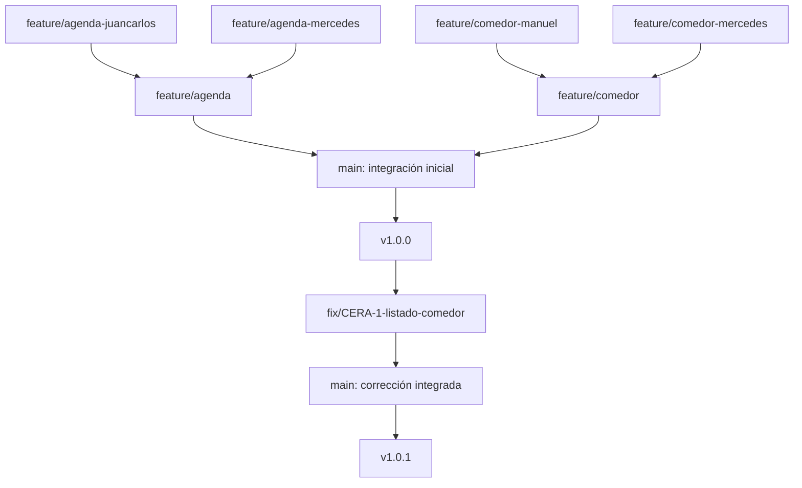

# Agenda CeRa — Práctica 9 de PGPI

Simulación académica de la gestión de la configuración del software. Universidad de Granada, curso 2026/2027. 

La aplicación propuesta facilita la organización del tiempo y las actividades mediante una agenda accesible y personalizable. Los archivos `.txt` de este repositorio representan cambios de código, no son una aplicación ejecutable ni contienen datos reales del alumnado.

## Estado de la práctica

La simulación técnica está completada: las dos tareas se han integrado en `main`, se han publicado las etiquetas `v1.0.0` y `v1.0.1` y la incidencia [CERA-1](https://pgpi-practicas.atlassian.net/browse/CERA-1) se encuentra en estado Listo.

El historial hasta `v1.0.1` contiene 22 commits alcanzables desde la versión, incluidas las ocho aportaciones personales y siete commits de merge (seis de las tareas y uno de la corrección). Se conservan nueve ramas, incluida una rama histórica no integrada.

## Equipo

| Integrante | Función general (P1–P2) |
|---|---|
| Mercedes Lorenzo Aragón | Coordinación y dirección |
| Juan Carlos Montes Ronda | Planificación y gestión técnica |
| Manuel Martínez Cobos | Seguimiento y control de calidad |

## Tareas y ramas de desarrollo

| Tarea | Referencia P3 | Rama | Responsable | Participantes |
|---|---|---|---|---|
| Agenda diaria/semanal | E03 / SCRUM-24 | `feature/agenda` | Juan Carlos | Juan Carlos y Mercedes |
| Gestión del comedor | E04 / SCRUM-11 | `feature/comedor` | Manuel | Manuel y Mercedes |

Las referencias SCRUM corresponden al backlog de la práctica 3; la incidencia de la práctica 9 se gestiona en un espacio Jira independiente.

| Rama personal | Rama de origen | Integrante | Aportación |
|---|---|---|---|
| `feature/agenda-juancarlos` | `feature/agenda` | Juan Carlos | Modelo y filtrado de agenda |
| `feature/agenda-mercedes` | `feature/agenda` | Mercedes | Presentación accesible diaria/semanal |
| `feature/comedor-manuel` | `feature/comedor` | Manuel | Registro de comensales y dietas |
| `feature/comedor-mercedes` | `feature/comedor` | Mercedes | Generación del listado diario |

`main` es la rama estable. Los responsables inicializaron dos archivos por tarea y cada participante realizó dos commits de desarrollo en su rama personal. Las cuatro aportaciones se integraron en las respectivas ramas de tarea; después Juan Carlos integró agenda y Manuel integró comedor en `main`. Se emplearon merges explícitos (`--no-ff`), sin squash, y se conservaron las ramas para la evaluación.



El diagrama representa el flujo de integración, no el grafo exacto de commits. Las ramas personales se crearon a partir de sus ramas de tarea.

## Versiones publicadas

| Versión | Commit de destino | Contenido |
|---|---|---|
| [`v1.0.0`](https://github.com/MercheLorenzo/agenda-cera-pgpi-p9/tree/v1.0.0) | `034f40d` | Integración inicial de agenda y comedor. Incluye el defecto simulado del listado. |
| [`v1.0.1`](https://github.com/MercheLorenzo/agenda-cera-pgpi-p9/tree/v1.0.1) | `69b73ba` | Corrección del listado diario del comedor (CERA-1). |

Las dos etiquetas anotadas identifican hitos distintos e inmutables del historial. Los cambios de documentación posteriores no alteran dichas versiones.

Consulta el [historial de cambios](CHANGELOG.md) y la [comparación de versiones](https://github.com/MercheLorenzo/agenda-cera-pgpi-p9/compare/v1.0.0...v1.0.1).

## Gestión de la incidencia en Jira

Se registró un error simulado en el listado diario del comedor: la versión inicial incluía a estudiantes que no asistirían al comedor. Mercedes se encargó de la corrección.

- Incidencia definitiva: [CERA-1](https://pgpi-practicas.atlassian.net/browse/CERA-1) — Error (Bug), estado Listo.
- Rama integrada: [`fix/CERA-1-listado-comedor`](https://github.com/MercheLorenzo/agenda-cera-pgpi-p9/tree/fix/CERA-1-listado-comedor).
- Commit de corrección: [`4960f21`](https://github.com/MercheLorenzo/agenda-cera-pgpi-p9/commit/4960f216a3ef87421ea1fb35cc2868cab5c5e334) — `CERA-1 fix: excluir registros sin asistencia del listado`.
- Merge en `main`: [`69b73ba`](https://github.com/MercheLorenzo/agenda-cera-pgpi-p9/commit/69b73ba15810e6d0f9c0aa4bd4f3ee923591aaff).

La integración GitHub for Atlassian permite consultar la rama y los commits relacionados en el panel Desarrollo de la incidencia.

### Rama histórica CERAP

El primer espacio Jira se creó con una plantilla empresarial, que no mostraba el panel de Desarrollo necesario. Se trasladó la incidencia `CERAP-1` al espacio de software, donde pasó a identificarse como `CERA-1`. Se recuperó la misma corrección en una nueva rama y un nuevo commit con la clave definitiva. La rama `fix/CERAP-1-listado-comedor` se conserva únicamente como histórico del cambio de espacio y no se ha integrado en `main`. No es una segunda incidencia funcional.

## Archivos de simulación

- `agenda/modelo.txt`: datos, filtro temporal y orden de tareas.
- `agenda/vista.txt`: modo de visualización y presentación accesible.
- `comedor/registro.txt`: registro ficticio de comensales y dietas.
- `comedor/listado.txt`: generación simulada del informe de comedor.

## Control de calidad

La comparación entre las versiones confirma que solo cambia `comedor/listado.txt`: tres líneas añadidas y tres eliminadas. La nueva regla filtra por fecha y `asistencia=si`, manteniendo la agrupación por aula y dieta y las restricciones de acceso descritas.

| Registro ficticio | v1.0.0 | v1.0.1 |
|---|---|---|
| E01 (asistencia sí) | Incluido | Incluido |
| E02 (asistencia no) | Incluido por error | Excluido |
| E03 (asistencia sí) | Incluido | Incluido |
| E04 (otra fecha) | Excluido | Excluido |
| **Total** | **3** | **2** |

```bash
git fetch origin --tags
git log --graph --oneline --decorate --all
git diff v1.0.0 v1.0.1
```

La comprobación es documental, no una prueba de software en ejecución. No se incorporan datos reales ni material del centro.

## Documentación y enlaces de entrega

- [Guía de contribución](CONTRIBUTING.md): normas de trabajo, integración y versionado.
- [Registro de cambios](CHANGELOG.md): contenido de cada versión.
- [Repositorio GitHub](https://github.com/MercheLorenzo/agenda-cera-pgpi-p9).
- [Primera versión etiquetada](https://github.com/MercheLorenzo/agenda-cera-pgpi-p9/tree/v1.0.0).
- [Segunda versión etiquetada](https://github.com/MercheLorenzo/agenda-cera-pgpi-p9/tree/v1.0.1).
- [Proyecto Jira — Agenda CeRa, práctica 9](https://pgpi-practicas.atlassian.net/jira/software/projects/CERA/boards/34).
- [Incidencia CERA-1](https://pgpi-practicas.atlassian.net/browse/CERA-1).

El repositorio es público. El equipo ha concedido acceso al profesor al espacio Jira y al repositorio para facilitar la evaluación.
